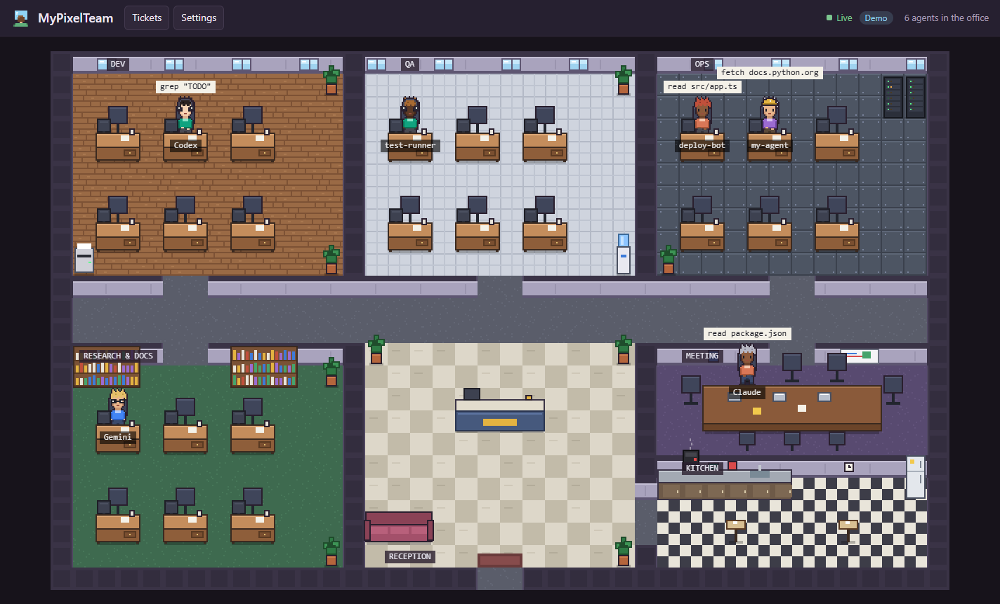

<div align="center">


# MyPixelTeam

**A pixel-art office where your AI coding agents live and work.**

Watch every Claude Code session as a little 16-bit character, and hand tickets to agents
that open the pull requests for you.

[](LICENSE)
[](https://www.electronjs.org/)
[](https://www.typescriptlang.org/)
[](https://nodejs.org/)
[](https://claude.com/claude-code)

[Quick start](#-quick-start) · [Features](#-features) · [How it works](#-how-it-works) · [Documentation](#-documentation)

<br />



</div>

<br />

## ✨ Features

### 👀 An office for the agents you already run

- **Zero setup.** Every Claude Code session on your machine shows up on its own, read from
  the transcripts Claude Code already writes.
- **Characters that show what's going on.** An agent walks in through the front door, sits
  at its team's desk, types while it uses tools (`edit src/app.ts`, `npm test`), thinks,
  raises its hand when it needs you, goes for coffee when idle, and leaves when it's done.
- **Subagents** spawn next to their parent and head to their own room. Sessions in plan
  mode gather in the meeting room.
- **Rooms by role** (`dev`, `qa`, `ops`, `research`), set by simple rules in
  [`office.config.json`](office.config.json) and reloaded live.
- **Optional hooks** for exact, real-time events (permission prompts, session ends),
  installed by a careful setup script that backs up your settings first.

### 🎫 A work tool for tickets

- **Connect GitHub, Bitbucket and/or Jira**, then let the app find your projects from your
  Claude Code history.
- **Put an agent on a ticket:** it works in its own git worktree, never in your checkout,
  moves the ticket along and opens the pull request.
- **Stay in the loop:** answer an agent's permission requests from the app, continue a
  finished run with new instructions or review comments, then review, merge or close its
  pull request without leaving the office.
- **Run several agents at once** with a queue, a dollar budget per run, whole epics run in
  order, and an automatic retry when a pull request's checks fail.
- **Tokens stay safe:** they're encrypted with the OS keystore and never written to
  `.git/config`.
- **English and French** interface.

### 🔌 Open to anything else

A tiny local HTTP API (`127.0.0.1` only) lets any script, CI job or other CLI put its own
characters in the office with a single `curl`.

## 🚀 Quick start

You need **Node.js 22.12+** on Windows, macOS or Linux.

```bash
git clone https://github.com/Krymum/MyPixelTeam.git
cd MyPixelTeam
npm install
npm run demo     # the office with six simulated agents, no AI needed
```

Click a character to see what it's doing and its recent timeline.

To watch your real agents, start the app without the demo, then use Claude Code as usual:

```bash
npm run dev
```

Your sessions show up in the office on their own. For permission prompts and exact session
ends, install the hooks too (optional):

```bash
npm run setup:claude
```

On first launch, a setup guide checks your machine, connects your accounts and finds your
projects so you can put agents on tickets.

### 🪟 Windows executable

```bash
npm run dist     # builds dist/MyPixelTeam.exe, a single portable file
```

Copy the `.exe` anywhere and double-click it. It isn't signed, so SmartScreen may ask for
confirmation the first time. Its settings live in `%APPDATA%\agent-office\`.

## 🧭 How it works

```
 Claude Code ──writes──▶ ~/.claude/projects/**/*.jsonl ──read──────────────▶
 Claude Code ──hook───▶ adapters/claude-code.mjs ──POST──▶ 127.0.0.1:4777 ──▶  the office
 your script ─────────────── curl ────────────────POST──▶ /events ─────────▶
```

- **Observing:** the app follows Claude Code's transcript files, read-only. Hooks, when
  installed, send exact events to a small server inside the app; a hook never blocks or
  slows Claude Code, even when the app is closed.
- **Working:** when you put an agent on a ticket, the app runs `claude -p` in a fresh git
  worktree, passes its permission requests on to you, then commits, pushes and opens the
  pull request.
- **Drawing:** a pure TypeScript simulation decides where everyone is and what they do; the
  canvas renderer only draws it. Every sprite is drawn in code: no third-party assets.

## 📚 Documentation

| Guide                                              | What's inside                                                                      |
| -------------------------------------------------- | ---------------------------------------------------------------------------------- |
| [Watching your agents](docs/claude-code.md)        | Transcripts vs hooks, the setup script, what each animation means, rooms and roles |
| [Working on tickets](docs/tickets.md)              | Accounts and tokens, projects, running agents, answering them, notifications       |
| [Event protocol & configuration](docs/protocol.md) | Sending events from any program, server endpoints, environment variables           |
| [Development](docs/development.md)                 | Scripts, project layout, adding support for another CLI                            |

## 🗺️ Status

| Piece                               | State                              |
| ----------------------------------- | ---------------------------------- |
| Office, characters, animations      | ✅ done                            |
| Claude Code (transcripts and hooks) | ✅ done, tested with live sessions |
| Agents on tickets                   | ✅ done                            |
| GitHub, Bitbucket Cloud, Jira Cloud | ✅ done                            |
| Windows executable                  | ✅ done, unsigned                  |
| Codex CLI, Gemini CLI               | 🔜 planned                         |

Out of scope for now: Jira Data Center, GitLab, several accounts per service, a map editor.

## 🤝 Contributing

Issues and pull requests are welcome: see [CONTRIBUTING.md](CONTRIBUTING.md) to get set up.
Support for a new CLI is a great first contribution
([here's how](docs/development.md#adding-support-for-another-cli)).

## 📄 License

[MIT](LICENSE). MyPixelTeam is an independent project, not affiliated with Anthropic.
